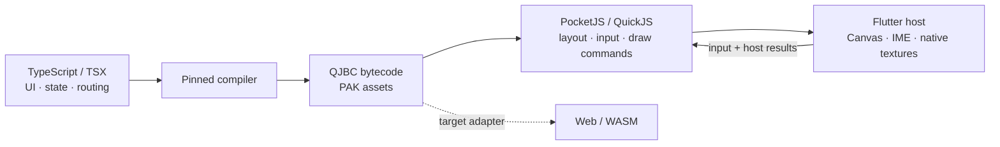
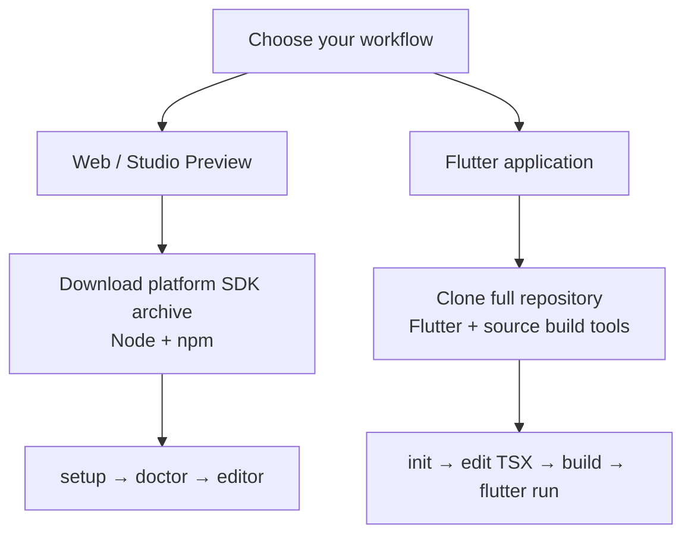
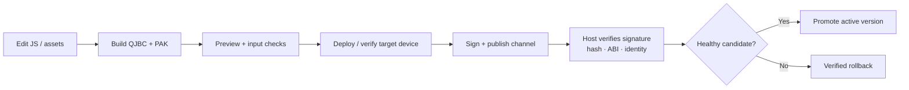
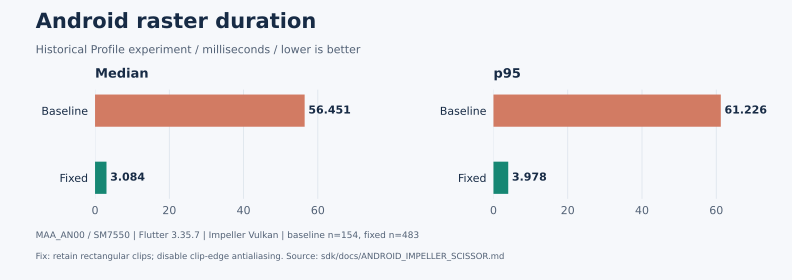

<div align="center">

# Pocket

**TypeScript UI. QuickJS bytecode. Flutter-native surfaces.**

Build **apps · games · visual novels · mini-app containers** with one JS application layer.


[Install](#install) · [Build your first app](#build-your-first-flutter-app) · [Features](#features) · [Results](#measured-results) · [Docs](#documentation)

</div>

| UI | Runtime | Native host | Tools | License |
| :---: | :---: | :---: | :---: | :---: |
| TypeScript / Solid | PocketJS / QuickJS | Flutter **3.50.0** | Node **≥22.22.2** | [MIT](LICENSE) · [third-party terms](LICENSING.md) |

## At a glance



| You write in JS | Pocket handles | Flutter provides |
| --- | --- | --- |
| Components, state, navigation, game/story rules | Bytecode execution, layout, draw commands, resource contracts | Canvas, system keyboard, lifecycle, resource decoding, registered plugins |

[Architecture](sdk/docs/OVERVIEW.md) · [JS/host boundaries](sdk/docs/AI_APP_DEVELOPMENT.md) · [Binary frames](sdk/docs/BINARY_BRIDGE_PROTOCOL.md)

## Features

| Build | Included | Explore |
| --- | --- | --- |
| **Product UI** | Themes, forms, lists, dialogs, navigation, scrolling | [Components](sdk/docs/COMPONENTS.md) · [Mobile motion](sdk/docs/MOBILE_MOTION.md) |
| **Design systems** | Core UI, paper/marker styling, semantic tokens and calm motion | [UI](sdk/packages/pocket_ui/) · [Looseleaf](sdk/packages/pocket_looseleaf/) · [ARC](sdk/packages/pocket_arc/) |
| **Text and adaptive input** | Native fonts, inline text, system IME, keyboard-aware scroll, safe areas/display panes | [Text](sdk/docs/INLINE_TEXT_IMPLEMENTATION.md) · [IME](sdk/docs/INPUT_REUSE.md) · [Duo](sdk/docs/DUO_ADAPTATION.md) |
| **Games** | App/Game starters, frame hooks, input and business Workers | [Templates](sdk/docs/PROJECT_TEMPLATES.md) · [Game demos](sdk/docs/OFFICIAL_GAME_DEMOS.md) |
| **Mini-app containers** | JS SystemUI, catalogs, stacks, messages/results, prewarm/eviction, isolated storage | [Multi-app](sdk/docs/MULTI_APP_IMPLEMENTATION.md) · [On-demand apps](sdk/docs/ON_DEMAND_MINI_APPS.md) |
| **Media and models** | Audio, managed local video, Spine and Live2D adapters | [Audio](sdk/docs/VISUAL_NOVEL_AUDIO.md) · [Video](sdk/docs/VIDEO_SHOWCASE_VALIDATION.md) · [Spine](sdk/docs/VISUAL_NOVEL_SPINE.md) · [Live2D](sdk/docs/VISUAL_NOVEL_LIVE2D.md) |
| **Hardware** | Optional camera/photos, BLE/GATT, sensors, location/weather, biometrics | [Modules](sdk/docs/HARDWARE_MODULES.md) · [Local BLE Preview](sdk/docs/LOCAL_BLUETOOTH_PREVIEW.md) |
| **System and network** | Permissions, haptics, system bars, opt-in links, Worker HTTP, Dio IO isolate | [Plugins](sdk/docs/OPTIONAL_PLUGINS.md) · [Workers](sdk/docs/WORKER_IO_IMPLEMENTATION.md) · [Dio](sdk/docs/DIO_WORKER.md) |
| **Fast paths** | Binary frames, retained chunks/caches, deadline wakeups, batched 16-byte SPSC records | [Scheduling](sdk/docs/GLYPH_AND_SCHEDULER_IMPLEMENTATION.md) · [Duplex](sdk/docs/DUPLEX_TRANSPORT.md) |
| **Resources** | PAK packaging, revision tracking, quota/path-checked native ZIP/7z extraction, JS byte codecs | [Archives](sdk/packages/pocket_archive/README.md) · [UTF-8/Base64](sdk/packages/pocket_ui/src/bytes.ts) |
| **Updates and limits** | Signed delivery, verified rollback, capability grants, execution/realm-heap/PAK budgets | [Updates](sdk/docs/PACKAGE_UPDATE_MODES.md) · [Memory](sdk/docs/APP_MEMORY_LIMITS.md) · [Trust](sdk/docs/RELEASE_TRUST_POLICY.md) |
| **Debugging and Studio** | Real Preview, source/assets, device deployment, channels, SDK upgrade, bounded recording/replay | [Studio](sdk/docs/EDITOR_STUDIO.md) · [Recording](sdk/docs/RECORDING_REPLAY.md) · [Diagnostics](sdk/docs/DIAGNOSTICS_PACKAGE.md) |

### Visual novels

| Story | Presentation | Player progress | Authoring |
| --- | --- | --- | --- |
| Dialogue, choices, branches, variables, player input | Scene layers, camera/timeline, rich text, voice, Spine/Live2D | Save slots/thumbnails, rollback, backlog, auto/skip, gallery, inventory, localization | Script/graph editing, contextual preview, debug, history, backup/restore |

[Feature tour](sdk/docs/VISUAL_NOVEL_FEATURE_TOUR.md) · [Engine](sdk/docs/VISUAL_NOVEL_ENGINE.md) · [Editor](sdk/docs/VISUAL_NOVEL_EDITOR.md) · [Showcase: The Last Letter of Mist Harbor](sdk/docs/VISUAL_NOVEL_GAME.md) · [Remaining gaps](sdk/docs/VISUAL_NOVEL_LETSGAL_PARITY.md)

## Install

The installer downloads and verifies the official standalone Web SDK / Studio release for your platform. Use Node.js ≥22.22.2 and npm on macOS arm64 or Windows x64. On Windows, use `curl.exe` in the command below.

```sh
curl -fsSL https://raw.githubusercontent.com/PocketFlutter/Pocket/main/sdk/scripts/install_studio.mjs | node --input-type=module -
```

[Installer options and directory protection](sdk/docs/INSTALL_STUDIO.md) · [Project API documentation](sdk/docs/API.md)



| Workflow | Required | Start here |
| --- | --- | --- |
| **Web / Studio** | Node ≥22.22.2, npm; macOS arm64 or Windows x64 | [SDK 0.1.27 downloads](https://github.com/PocketFlutter/Pocket/releases/tag/sdk-v0.1.27) |
| **Flutter integration / source** | Flutter 3.50.0/Dart 3.14.0, Bun, Python 3, `patch`, Rust ≥1.93, platform C/C++ tools | [Source repository](https://github.com/PocketFlutter/Pocket) · [Integration](sdk/docs/SDK_INTEGRATION.md) |

Public Flutter constraints remain Flutter ≥3.35.0 / Dart ^3.9.2; this repository pins 3.50.0. Release CI uses Rust 1.98.1. [Toolchain details](sdk/docs/NPM_TOOLCHAIN.md)

### Web / Studio: download and run

**1.** Download the matching **standalone SDK** archive and extract it:

| Computer | Release attachment |
| --- | --- |
| macOS Apple Silicon | `pocket-web-sdk-tools-darwin-arm64-VERSION.tgz` |
| Windows x64 | `pocket-web-sdk-tools-win32-x64-VERSION.tgz` |

**2.** In the extracted `package/` directory, run the same commands in Terminal or PowerShell:

```sh
npm run setup
npm run doctor
npm run editor
```

**3.** Open **[localhost:8791](http://127.0.0.1:8791)** → **New project** → **App** or **Game** → **Build** → interact with Preview.

| Daily action | Command / UI |
| --- | --- |
| Open or restart Studio | `npm run editor` |
| Check service / stop | `npm run status` / `npm stop` |
| Open an existing project | Open project → paste its absolute folder path; source stays in place |
| Create outside the workspace | New project → optional save directory |
| Edit and rebuild | Select project → edit `app.tsx` → Build |
| Share a local preview | Copy preview link; LAN access needs explicit setup |
| Export browser output | `npm run build:web -- --project-root=/path/to/project --outdir=/path/to/web` |

The archive supplies Bun and native compiler/probe tools. It does **not** include the full Flutter SDK source or `init/build` npm scripts; use the next tutorial for native apps. Packages are distributed as release archives, not through `npm install pocket` or pub.dev.

[Studio walkthrough](sdk/docs/EDITOR_STUDIO.md) · [Web output](sdk/docs/WEB_SDK_EXPORT.md) · [LAN preview](sdk/docs/EDITOR_LAN_ACCESS.md) · [Windows toolchain](sdk/docs/WINDOWS_BUILD.md)

## Build your first Flutter app

### 1. Prepare the SDK and create a project

Apple Silicon **macOS** example; install the source prerequisites above and Xcode first:

```sh
git clone https://github.com/PocketFlutter/Pocket.git pocket
cd pocket/sdk
export POCKET_SOURCE_BUILD=1
bun install --frozen-lockfile
python3 scripts/prepare_upstream.py
bun pocket.ts init ../../my-pocket-app --template=app --sdk-root .
```

Use `--template=game` for the game starter. Keep the SDK checkout: the generated Flutter project references it by path.

### 2. Edit `my-pocket-app/app.tsx`

```tsx
import { createSignal } from "solid-js";
import { mount } from "@pocketjs/framework/solid";
import { Text, View } from "@pocketjs/framework/solid/components";
import { MobileButton, SafeAreaScaffold } from "@pocket/ui";

function App() {
  const [count, setCount] = createSignal(0);
  return (
    <SafeAreaScaffold>
    <View class="w-full h-full flex-col gap-4 p-6 bg-slate-50">
      <Text class="text-xl text-slate-950">Hello Pocket · {count()}</Text>
      <MobileButton label="+1" onPress={() => setCount(count() + 1)} />
    </View>
    </SafeAreaScaffold>
  );
}

mount(() => <App />);
```

### 3. Build and run

Continue in `pocket/sdk` in the same shell:

```sh
bun pocket.ts build ../../my-pocket-app --sdk-root . --platform=macos
cd ../../my-pocket-app/flutter
flutter pub get
flutter run -d macos
```

Click **+1**: JS state changes and the native host draws the next frame.

| Target | Build option | Native requirements |
| --- | --- | --- |
| macOS arm64 | `--platform=macos` | Xcode |
| iOS arm64 simulator | `--platform=ios-sim` | Xcode + simulator Rust target |
| iOS arm64 device | `--platform=ios` | Xcode + Rust target + signing |
| Android arm64 | `--platform=android` | Android SDK/NDK + Rust target |

For devices, run `flutter devices`, then `flutter run -d DEVICE_ID`. Rebuild QJBC after JS edits; rebuild native libraries after Rust/ABI changes. Flutter hot reload does not compile Rust.

### 4. Use the generated project commands

Run from `my-pocket-app/` (keep `POCKET_SOURCE_BUILD=1` for the source workflow):

| Command | Action |
| --- | --- |
| `npm start` | Open Studio bound to this project and its Flutter host |
| `npm run build` | Build bytecode and stage native-consumer assets |
| `npm run build -- --platform=macos` | Also prepare the target native library |
| `npm run build:web` | Export browser output under `build/web/` |
| `npm run editor:status` / `npm run editor:stop` | Manage the SDK's Studio service |

Studio-created projects get the same command names for JS/Preview builds; they do not automatically create a Flutter host. Projects can move on disk while keeping the same SDK location. [Scaffold and opening guide](sdk/docs/PROJECT_SCAFFOLD_AND_OPEN_20261114.md)

### 5. Add capabilities or embed in an existing app

| Need | Integration entry |
| --- | --- |
| Embed in a Flutter screen | `PocketGuest` · [Integration guide](sdk/docs/SDK_INTEGRATION.md) |
| Standalone shell / multi-app host | `PocketApp` / `PocketSystemHost` · [SDK API](sdk/README.md) |
| Camera, BLE, sensors… | `init` flags such as `--camera`, `--bluetooth`, `--sensors` · [Hardware](sdk/docs/HARDWARE_MODULES.md) |
| Dio HTTP | `--dio`, network grant, explicit allowed origins · [Dio setup](sdk/docs/DIO_WORKER.md) |
| Haptics / system bars / deep links | `--platform-experience` / `--deep-link-scheme=pocketapp` · [Options](sdk/docs/OPTIONAL_PLUGINS.md) |
| Run the full Showcase | [Demo setup](demo/README.md) · [Live2D/asset acceptance](sdk/docs/FLUTTER_3_50_UPGRADE.md) |

The full Showcase needs separately prepared Lantern assets and authorized Cubism Core; the minimal app above does not.

## Develop and publish



| Step | How / reference |
| --- | --- |
| Bind Studio to your native consumer | From repository `sdk/`: `npm run editor -- --project-root=/path/to/my-pocket-app --flutter-root=/path/to/my-pocket-app/flutter` after matching prebuilt-tool setup |
| Configure publishing | Host public key/update URL; release-side signing key · [Update setup](sdk/docs/SDK_INTEGRATION.md) |
| Build / publish / inspect versions | Studio project + channel controls · [Version backend](sdk/docs/EDITOR_VERSION_BACKEND.md) |
| Activate and recover | Host checks, health window, last-good/bundled fallback · [Update modes](sdk/docs/PACKAGE_UPDATE_MODES.md) |
| Rotate/revoke release keys | [Trust policy](sdk/docs/RELEASE_TRUST_POLICY.md) |

Guest updates deliver JS bytecode/assets; native plugins remain compiled into the host. Keep signing private keys on the publishing side.

## Measured results



**Same scene/device:** MAA_AN00 / SM7550 · Flutter **3.35.7** · Impeller Vulkan · **Profile** · baseline **154** / fixed **483** frames. Rectangular clips are retained; only clip-edge AA changes. [Full ablation + reproduction](sdk/docs/ANDROID_IMPELLER_SCISSOR.md)

| Check | Recorded result | Evidence |
| --- | --- | --- |
| Android Release presentation | Median **16.707 ms**, p90 **16.709 ms**, 98 intervals | [SurfaceFlinger; not raster duration](sdk/docs/ANDROID_IMPELLER_SCISSOR.md#release-device-acceptance-results) |
| Deadline scheduling | **300 → 1** observation callbacks; same virtual-frame-300 deadline | [Native scheduling fixture](sdk/docs/GLYPH_AND_SCHEDULER_IMPLEMENTATION.md) |
| Offline replay | **402 transactions / 145 frames** matched after original-session disposal | [Recorded input/viewport/host workload](sdk/docs/PERFORMANCE.md) |
| Minimal Android host | **10.83 MiB compact APK** / **22.83 MiB** directly mapped native libraries; arm64 + split debug info, no heavy Showcase assets. Compact mode extracts libraries on install | [Build + size report](sdk/docs/HOST_PACKAGE_SIZE_20261114.md) |
| Minimal iOS host | **23.67 MiB** unsigned arm64 Release `.app` with split debug info; local unsigned IPA ZIP **9.97 MiB** (not App Store download size) | [iOS build + size report](sdk/docs/HOST_PACKAGE_SIZE_20261114.md#ios-release-measurements-on-device) |
| Minimal macOS host | **30.03 MiB** Release / **28.97 MiB** with split debug info; corresponding local ZIP **11.69 MiB** | [Size breakdown + build commands](sdk/docs/HOST_PACKAGE_SIZE_20261114.md) |
| Flutter 3.50 upgrade | **620 passed**, plus **10 skipped** fixture-dependent SDK tests | [277 renderer + 89 services + 200 SDK + 54 Showcase](sdk/docs/FLUTTER_3_50_UPGRADE.md) |
| Looseleaf / ARC | Pointer input: **0 → 1 → 11**; changed native DrawOps | [Real bytecode integration](sdk/docs/LOCAL_WORK_CONFLICT_RESOLUTION_20261113.md) |

Historical measurements, not a new 3.50 benchmark or universal FPS/battery promise. **Flutter FPS ≠ Guest ticks/s.** [Measurement guide](sdk/docs/FLUTTER_FPS.md) · [Chart source](docs/render_readme_charts.py)

## Platform coverage

| Target | Status / scope | Details |
| --- | --- | --- |
| iOS arm64 | Native host; device + Apple Silicon simulator; iOS 15+ | [Integration](sdk/docs/SDK_INTEGRATION.md) |
| Android arm64 | Native host; API 24+; recorded physical-device tests | [Device evidence](sdk/docs/ANDROID_IMPELLER_SCISSOR.md) |
| macOS arm64 | Flutter 3.50 build + model Showcase passed on macOS 27.2; minimum declared 12 | [Acceptance](sdk/docs/FLUTTER_3_50_UPGRADE.md) |
| Windows x64 tools | Historical CI: SDK install, compiler/probe, Preview/Studio; not BLE device proof | [Windows tools](sdk/docs/WINDOWS_BUILD.md) |
| Windows Flutter | Runner/DLL integration exists; GUI/runtime acceptance remains separate | [Host scope](sdk/docs/WINDOWS_FLUTTER.md) |
| Web / WASM | Real QJBC execution + recorded Chromium interactions; host capabilities vary | [Web](sdk/docs/WEB_SDK_EXPORT.md) |
| WeChat | Single-guest adapter; Node WASM tests; no DevTools/device acceptance or multi-app/Worker HTTP | [Scope](sdk/docs/WECHAT_HOST_IMPLEMENTATION.md) |
| Linux | No equivalent validated SDK distribution / Flutter-host acceptance claimed | [Toolchain scope](sdk/docs/NPM_TOOLCHAIN.md) |

## Troubleshooting

| Symptom | Next step |
| --- | --- |
| Setup reports missing/stale platform tools | Use the SDK archive matching your OS/CPU and SDK version; run `npm run doctor`. [Tool admission](sdk/docs/NPM_TOOLCHAIN.md) |
| Edits do not appear | Build the selected JS project again; saving TSX does not replace loaded QJBC. [Preview](sdk/docs/EDITOR_PREVIEW_PAGE.md) |
| Native symbol / ABI mismatch | Rebuild native library + guest + Flutter app from matching sources. [Toolchain](sdk/docs/TOOLCHAIN_NOTES.md) |
| Port 8791 is busy | `npm run status` / `npm stop`; unrelated processes are not terminated. [Studio](sdk/docs/EDITOR_STUDIO.md) |
| Hardware denied / unsupported | Check provider registration, manifest grant, then OS permission. [Permissions](sdk/docs/HARDWARE_MODULES.md) |
| Live2D Core or Lantern assets missing | Follow authorized resource preparation; no bundled Core or fake model fallback. [Showcase acceptance](sdk/docs/FLUTTER_3_50_UPGRADE.md) |

## Documentation

| Build | Extend | Operate |
| --- | --- | --- |
| [AI app guide](sdk/docs/AI_APP_DEVELOPMENT.md) | [Plugins](sdk/docs/OPTIONAL_PLUGINS.md) | [Studio](sdk/docs/EDITOR_STUDIO.md) |
| [SDK integration](sdk/docs/SDK_INTEGRATION.md) | [Worker IO](sdk/docs/WORKER_IO_IMPLEMENTATION.md) | [Signed updates](sdk/docs/PACKAGE_UPDATE_MODES.md) · [Tencent COS publish](sdk/docs/COS_PUBLISH.md) |
| [App/Game templates](sdk/docs/PROJECT_TEMPLATES.md) | [Multi-app compositor](sdk/docs/SYSTEM_COMPOSITOR_IMPLEMENTATION.md) | [Recording/replay](sdk/docs/RECORDING_REPLAY.md) |
| [Visual novel authoring](sdk/docs/VISUAL_NOVEL_AUTHORING.md) | [Host security](sdk/docs/GUEST_SECURITY.md) | [Diagnostics](sdk/docs/DIAGNOSTICS_PACKAGE.md) |
| [SDK source](sdk/README.md) | [Framework architecture](sdk/docs/FRAMEWORK_GUIDE.md) | [Validation](sdk/docs/VALIDATION.md) |
| [Showcase](demo/README.md) | [Upstream provenance](sdk/docs/PROVENANCE.md) | [Performance](sdk/docs/PERFORMANCE.md) |

<details>
<summary>Runtime guarantees and limits</summary>

- QuickJS bytecode is VM bytecode, not ARM machine code. Production has no application-source evaluation fallback.
- PFB1 uses safe copying/decoding; it is not end-to-end zero-copy. Lock-free applies to SPSC queue data paths.
- Host policy → guest declarations → OS authorization. Guest packages cannot install native code.
- Per-realm JS heap budgets do not cover total RSS, GPU textures, or all Workers. [Memory limits](sdk/docs/APP_MEMORY_LIMITS.md)
- Studio is a local developer tool, not an untrusted multi-tenant build sandbox.
- PocketJS revision `99924de47c62fa36f526a8791055d91cbbdb3836`, archive SHA-256, controlled patches and lockfiles define reproducible inputs. [Bootstrap](sdk/scripts/prepare_upstream.py)

</details>

**License** · Pocket’s first-party code is licensed under the [MIT License](LICENSE). Dependencies, fonts, models, and artwork retain their own terms, and Cubism Core is separately licensed. See [third-party notices](LICENSING.md#upstream-and-third-party-components) and [Editor provenance](sdk/editor/NOTICE.md).
